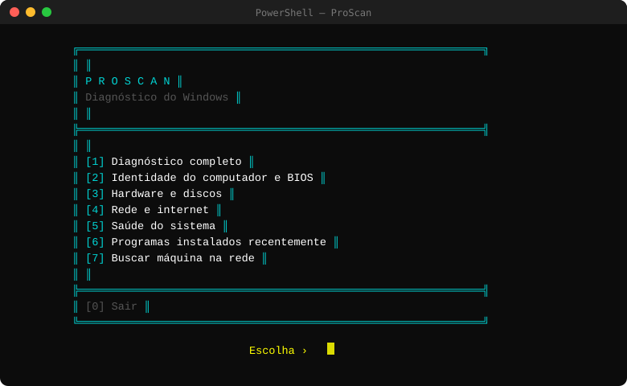

# ProScan — Diagnóstico do Windows

> Ferramenta de diagnóstico para ambientes Windows corporativos, desenvolvida em **PowerShell puro**, sem necessidade de instalação de dependências externas.

---

## Sobre o projeto

O **ProScan** nasceu da necessidade de agilizar o suporte de TI no dia a dia. Em vez de abrir vários painéis do Windows para coletar informações básicas de uma máquina, o ProScan centraliza tudo em um único terminal — com interface visual, cores por status e animação de carregamento para operações demoradas.

Funciona em modo **somente leitura**: não altera configurações, não reinicia serviços e não instala nenhum componente.

---

## Preview



---

## Funcionalidades

| Opção | Descrição |
|-------|-----------|
| `[1]` Diagnóstico completo | Executa todas as seções em sequência |
| `[2]` Identidade e BIOS | Nome do computador, usuário, domínio, fabricante, modelo, serial, versão do BIOS e último login |
| `[3]` Hardware e discos | Processador com percentual de uso atual, memória RAM usada e total com barra visual, discos locais com alerta colorido por espaço livre |
| `[4]` Rede e internet | Domínio corporativo, gateway padrão, teste de conectividade (1.1.1.1 / 8.8.8.8), resolução DNS, adaptadores de rede físicos |
| `[5]` Saúde do sistema | Tempo ligado (uptime), status do Remote Desktop (RDP), serviços essenciais do Windows, atualizações pendentes, erros críticos no Event Log dos últimos 7 dias |
| `[6]` Programas recentes | Últimos 15 programas instalados com data de instalação |
| `[7]` Buscar máquina na rede | Diagnóstico remoto completo via CIM/WMI: ping, DNS, dados do sistema, usuário(s) logado(s), status do RDP, discos, rede, serviços e programas instalados |

---

## Destaques técnicos

- **Spinner animado** — exibido durante operações lentas (consultas de rede, Windows Update, Event Log, acesso remoto) para indicar que o sistema está processando
- **Cores por status** — verde para serviços ativos e conexões bem-sucedidas, amarelo para alertas, vermelho para falhas críticas
- **Alerta de disco** — amarelo quando o espaço livre está abaixo de 20%, vermelho abaixo de 10%
- **Consulta remota com timeout** — ao buscar uma máquina via `[7]`, todas as consultas CIM/WMI têm timeout de 10 segundos, evitando que o script trave em máquinas inacessíveis
- **Detecção de domínio corporativo** — identifica automaticamente se a máquina está ingressada na rede
- **Compatível com PowerShell 5.1** — presente por padrão no Windows 10 e 11, sem necessidade de atualização

---

## Pré-requisitos

- Windows 10 ou Windows 11
- PowerShell 5.1 (já incluso no sistema operacional)
- Para a opção `[7]` (busca remota):
  - WMI/CIM habilitado na máquina de destino
  - Conta com permissão de administrador local na máquina remota
  - Porta 135 (RPC) liberada no firewall

---

## Instalação

**Opção 1 — Atalho na Área de Trabalho (recomendado)**

1. Copie a pasta para `C:\ProScan\`
2. Clique com o botão direito em `Install-ProScanShortcut.ps1`
3. Selecione **Executar com PowerShell**
4. O atalho **ProScan** será criado automaticamente na Área de Trabalho

**Opção 2 — Execução direta pelo terminal**

```powershell
powershell.exe -NoProfile -ExecutionPolicy Bypass -File "C:\ProScan\ProScan.ps1"
```

---

## Estrutura do repositório

```
ProScan/
├── ProScan.ps1                  # Script principal
├── Install-ProScanShortcut.ps1  # Criação do atalho na Área de Trabalho
├── assets/
│   └── menu.svg                 # Preview do menu principal
└── README.md                    # Documentação
```

---

## Segurança

O ProScan opera exclusivamente em modo de leitura. Nenhuma configuração é alterada, nenhum serviço é reiniciado e nenhum arquivo externo é baixado ou executado. Todas as consultas utilizam APIs nativas do Windows (CIM, WMI, registro, Event Log).

---

## Histórico de versões

| Versão | Data | Alterações |
|--------|------|------------|
| v2.2 | 22/10/2026 | Spinner animado, status do RDP (local e remoto), último login, CPU e RAM em uso, alerta crítico de disco, atualizações pendentes do Windows, usuário logado remotamente |
| v2.1 | 20/10/2026 | Interface com caixas, menu centralizado, busca remota completa, opção `[0]` voltar ao menu |
| v2.0 | 19/10/2026 | Versão inicial modularizada |

---

## Autor

Desenvolvido por **Renato Moura** — TI | EXSA  
[GitHub](https://github.com/Reinattos)
